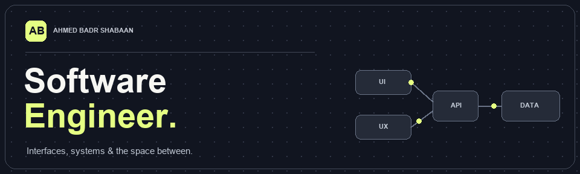

### Software Engineer · Angular, TypeScript & product systems · Cairo, Egypt

I build interfaces for complex workflows, with a focus on clear design, maintainable code, and the details that make software pleasant to use. Currently working with [Flagship Fintech](https://github.com/Flagship-Fintech).

[Explore my work](#featured-projects) · [Connect on LinkedIn](https://www.linkedin.com/in/ahmedbshaban/)

---

### What I build

`Angular` `TypeScript` `Next.js` `React` `Tailwind CSS` `NestJS` `Access control` `Localization`

I work across product portals, operations dashboards, and the systems behind them. Recent work includes healthcare workflows, e-commerce, merchant and settlement portals, and a work management platform. I enjoy turning complicated processes into interfaces people can navigate with confidence.

### 🚀 Featured projects

| Project | Tech | Highlights |
| :--- | :--- | :--- |
| **Clinic Management System** | Angular · TypeScript · Angular Material | Interfaces for administrators, doctors, and receptionists; patient reservations, doctor schedules, billing, and reports. *Private project* |
| **Souk Elkhodar** | Angular · SSR · Express · PostgreSQL | Bilingual storefront with catalog, cart, checkout, and order tracking; separate admin dashboard and API. *Private project* |
| [**Empire of Gold ↗**](https://empireofgold.co/) | Angular · TypeScript · SSR · Tailwind CSS | Public gold-commerce storefront with Arabic/English product discovery. Worked on Angular SSR and technical SEO, including canonical URLs, hreflang, dynamic metadata, robots.txt, and sitemap handling. |

### Work behind the scenes

Some of the most interesting systems I work on live in private repositories. The local projects include:

- **Merchant and operations portals:** Angular applications for onboarding, administration, and settlement workflows.
- **Commerce and trading interfaces:** Angular storefront, back-office, and chart-driven views.
- **Reusable portal foundations:** Shared UI patterns, environment profiles, and configurable branding across client-facing applications.
- **Full-stack product work:** Next.js interfaces connected to NestJS APIs, role-based access control, and PostgreSQL-backed services.

### How I like to build

**Make complex flows understandable.** Give people a clear path through dense information and multi-step tasks.

**Design for real permissions.** Reflect user roles in navigation and screens while keeping access rules explicit.

**Build for variation.** Support multiple environments, brands, and languages without duplicating whole applications.

### 📊 GitHub activity

[View my contribution activity and public repositories →](https://github.com/AhmedBadrShaban?tab=overview)

---

**Have a product problem worth solving together?**

[LinkedIn](https://www.linkedin.com/in/ahmedbshaban/) · [GitHub](https://github.com/AhmedBadrShaban)

